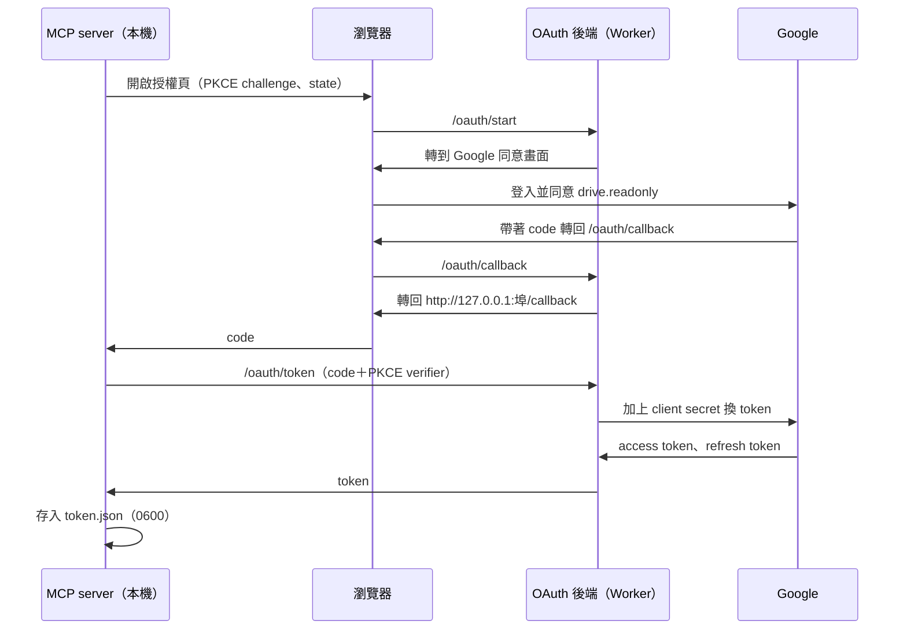
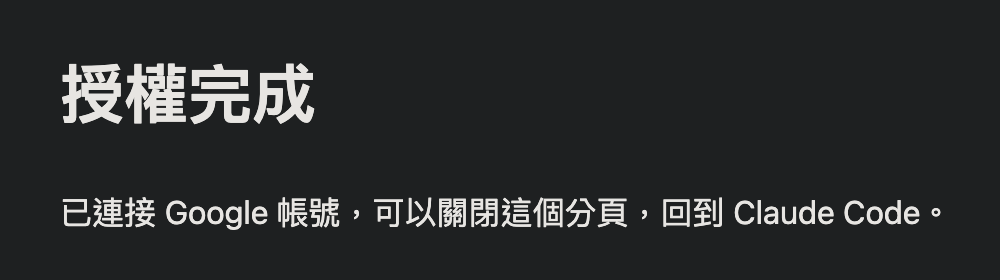
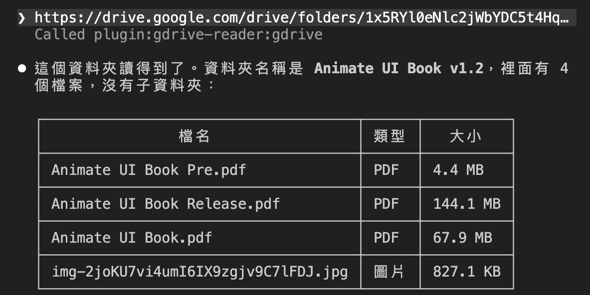
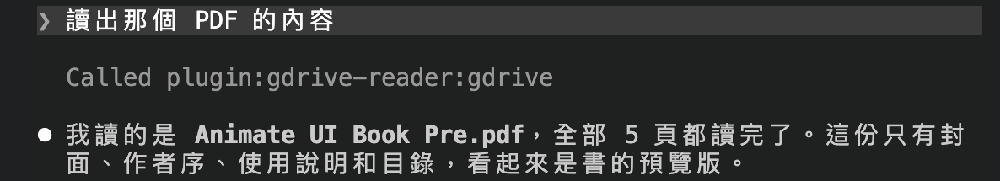
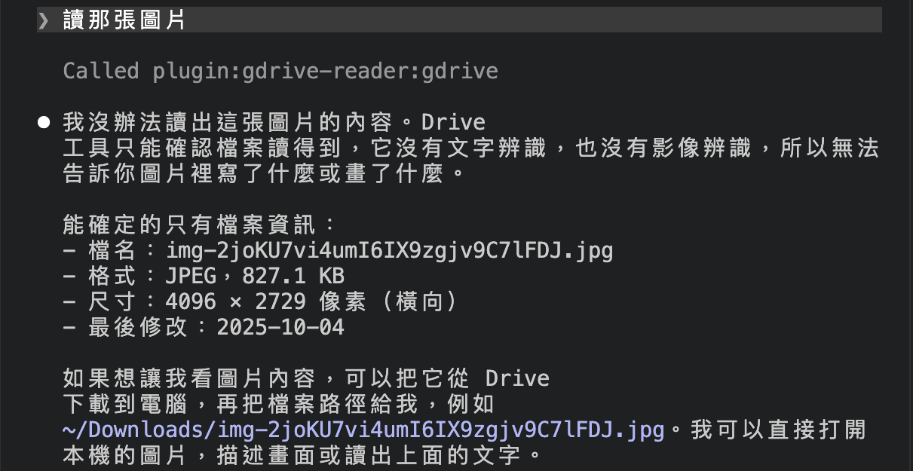

# Google Drive Reader：Claude Code Plugin

讓 Claude Code 透過 OAuth 連接你的 Google 帳號，以自然語言**列出** Google Drive 資料夾（含子資料夾）並**讀取**檔案內容。權限為唯讀，只能看到你的 Google 帳號本來就有權限看到的檔案。

```text
你：列出這個資料夾的檔案 https://drive.google.com/drive/folders/<資料夾ID>
Claude：（呼叫 list_folder）資料夾裡有 2 個檔案：report.pdf（PDF，1.2 MB）、photo.png（圖片，340 KB）…
你：讀出 report.pdf 的內容
Claude：（呼叫 read_file）以下是 PDF 第 1–3 頁的文字…
```

架構圖、技術選擇與取捨：[docs/ARCHITECTURE.md](docs/ARCHITECTURE.md)

```text
.
├── .claude-plugin/marketplace.json   # plugin marketplace 定義
├── plugin/                           # Claude Code plugin＋MCP server（Python，本機執行）
│   ├── .claude-plugin/plugin.json
│   ├── .mcp.json                     # Claude Code 啟動 MCP server 的設定
│   ├── src/gdrive_reader/            # server.py（工具）、oauth.py、auth.py、drive.py、reader.py …
│   └── tests/
├── backend/                          # OAuth 後端（FastAPI，部署在 Cloudflare Workers）
│   ├── src/worker.py
│   ├── wrangler.jsonc
│   └── tests/
└── docs/ARCHITECTURE.md
```

---

## 一、安裝與使用（使用已部署的後端）

### 前置需求

| 需求 | 說明 |
| --- | --- |
| Claude Code | 已登入即可 |
| [uv](https://docs.astral.sh/uv/) | 用來啟動 MCP server，會自動安裝 Python 與相依套件。安裝：`brew install uv` 或 `curl -LsSf https://astral.sh/uv/install.sh \| sh` |
| Google 帳號 | 需要對目標資料夾至少有「檢視者」權限 |
| 瀏覽器 | 用來完成 Google 登入；需要與 Claude Code 在同一台電腦 |

### 1. 安裝 plugin

在 Claude Code 中執行：

```text
/plugin marketplace add ADSFAaron/claude-gdrive-reader
/plugin install gdrive-reader@gdrive-reader-marketplace
/reload-plugins
```

執行 `/mcp`，確認 `plugin:gdrive-reader:gdrive` 的狀態是 connected。第一次啟動時 uv 會下載相依套件，可能需要十幾秒；若顯示 failed，請參考[疑難排解](#五疑難排解)。

### 2. 連接 Google 帳號

對 Claude 說「連接我的 Google 帳號」，或直接要求列出資料夾。Claude 會呼叫 `connect_google` 並開啟瀏覽器。

> **請使用被分享了目標資料夾的 Google 帳號登入。** 若是公司的 Google Workspace 帳號，管理員可能封鎖未經 Google 驗證的 App 存取雲端硬碟，此時會看到「This app is blocked」或 `access_denied`，請洽管理員，或改用另一個也被分享了資料夾的帳號。

1. 選擇要使用的 Google 帳號（需要有資料夾的檢視權限）
2. 同意畫面會顯示「**adsfaaron.workers.dev 要求存取您的 Google 帳戶**」，而不是 App 名稱。這是正常的：Google 只會為通過驗證的 App 顯示名稱，未驗證的 App 改顯示 OAuth 後端的網域
3. 若出現「**Google 尚未驗證這個應用程式**」，點「**進階**」→「**前往…（不安全）**」。原因是本 App 使用 restricted scope，而且未送 Google 審核（見 [ARCHITECTURE.md](docs/ARCHITECTURE.md) 4.4 節）
4. 確認權限是「**查看及下載您的所有 Google 雲端硬碟檔案**」（唯讀），按「繼續」
5. 頁面顯示「授權完成」後，關閉分頁回到 Claude Code

### 3. 列出與讀取

```text
列出這個資料夾的檔案：<貼上 Google Drive 資料夾的分享連結>
讀出裡面那個 PDF 的內容
那張圖片的資訊是什麼？
```

| 檔案類型 | 處理方式 |
| --- | --- |
| PDF | 下載後抽取文字層，標示頁碼；長文件可分頁讀取（`start_page`）。掃描檔沒有文字層，會明確回報「無法抽取文字（沒有 OCR）」 |
| 圖片 | **實際讀取檔案內容**以確認可讀取（大圖只讀開頭 64 KB），回報格式、大小、尺寸，並明確說明**不解析圖片內容** |
| 純文字類（txt、csv、json、md…） | 下載並解碼。UTF-8／UTF-16 直接解碼；Big5、Shift-JIS 等舊編碼自動判斷，並標註「判斷為 X 編碼」 |
| Google 文件／試算表／簡報 | 匯出為純文字／CSV |
| 其他（docx、xlsx…） | 回報中繼資料，說明不支援解析，不下載 |

### 4. 工具一覽

| 工具 | 用途 |
| --- | --- |
| `connect_google` | 開啟瀏覽器授權；`force=true` 可切換帳號 |
| `auth_status` | 顯示目前連接的帳號、授權範圍、token 存放位置 |
| `disconnect_google` | 向 Google 撤銷授權並刪除本機 token |
| `list_folder` | 遞迴列出資料夾（接受分享連結、網址或 ID） |
| `read_file` | 讀取單一檔案（接受 `list_folder` 回傳的 ID 或連結） |

### 5. 更新與移除

在終端機執行：

```bash
# 更新到最新版本
claude plugin marketplace update gdrive-reader-marketplace
claude plugin update gdrive-reader@gdrive-reader-marketplace

# 移除（建議先在 Claude Code 中呼叫 disconnect_google，向 Google 撤銷授權）
claude plugin uninstall gdrive-reader@gdrive-reader-marketplace
claude plugin marketplace remove gdrive-reader-marketplace
```

移除 plugin 時，Claude Code 會一併刪除存放 token 的資料目錄。

---

## 二、架構與授權流程



授權完成後，MCP server 直接用 access token 呼叫 Google Drive API，檔案內容不經過後端。

技術選擇摘要（完整理由見 [ARCHITECTURE.md](docs/ARCHITECTURE.md)）：

- **為什麼要後端**：Google Web application client 換 token 需要 client secret，secret 不能隨 plugin 發到使用者電腦，所以放在 Cloudflare Worker。後端只負責轉送和換 token，不存任何資料
- **OAuth flow**：Authorization Code＋PKCE（S256）。PKCE verifier 只存在本機程序中，授權碼經過瀏覽器也無法單獨使用；`state` 由本機驗證
- **Token 存本機**：後端不保管使用者憑證，可以完全無狀態
- **Scope 用 `drive.readonly`**：要列出被分享資料夾的子項目並讀取內容，`drive.file` 做不到

### Token 存放

- **位置**：refresh token 與 access token 存在本機的 `~/.claude/plugins/data/gdrive-reader-gdrive-reader-marketplace/token.json`
  - 檔案權限 `0600`、目錄權限 `0700`，以原子方式寫入
  - 不會出現在工具輸出、對話或 log 中（log 會遮蔽 token 格式的字串）
  - 解除安裝 plugin 時，Claude Code 會刪除這個目錄
- **後端不存任何 token**，也不會碰到 Drive 檔案內容
- **檔案內容**：在本機讀取，回傳給 Claude Code 後會成為對話的一部分
- **撤銷授權**：呼叫 `disconnect_google`，或到 [Google 帳號權限頁](https://myaccount.google.com/permissions) 移除；之後會要求重新授權
- **Token 過期**：access token 到期前一分鐘會透過後端自動更新。refresh token 失效（被撤銷、或 App 處於 Testing 模式超過 7 天）時，會清除本機 token 並提示重新授權

---

## 三、自行部署（自己的 OAuth Client 與後端）

以下是本 repo 已部署環境的建置方式，照做即可得到一份完全獨立的部署。

### A. 申請 Google OAuth Client

1. 到 [Google Cloud Console](https://console.cloud.google.com/) 建立專案 → 「API 和服務 → 程式庫」→ 啟用 **Google Drive API**
2. **Google Auth Platform → 開始使用**：填寫 App 名稱（不可含 Google 商標開頭，例如 `Folder Reader for Google Drive`）、支援 email，Audience 選 **External**
3. **Branding**：後端內建首頁與隱私權政策頁，B 部署完成後即可開啟。沒填這兩個網址，第 5 步的 Publish app 按鈕會反灰
   - Application home page：`https://gdrive-reader-auth.<你的子網域>.workers.dev/`
   - Application privacy policy link：`https://gdrive-reader-auth.<你的子網域>.workers.dev/privacy`
   - Authorized domains：`<你的子網域>.workers.dev`
   - 不要上傳 App logo：上傳後必須先通過 Google 的品牌審核
4. **Data Access** → 新增 scope `https://www.googleapis.com/auth/drive.readonly`
5. **Audience** → 按 **Publish app** 切到 **In production**：任何帳號都能授權，但會看到「未驗證」警告，且上限 100 位使用者。不需要送 Google 審核
   - 若維持 **Testing**：只有加入「測試使用者」的帳號能授權，且授權在 7 天後失效
6. **Clients → Create client** → 類型 **Web application**，Authorized redirect URIs 填：
   - `https://gdrive-reader-auth.<你的子網域>.workers.dev/oauth/callback`
   - `http://localhost:8787/oauth/callback`（本機開發用，可省略）
7. 建立後**立即下載 client secret**（Google 只顯示一次），存放在 repo 以外的位置

### B. 部署後端到 Cloudflare Workers

需要 Cloudflare 帳號、uv、Node.js。

```bash
cd backend
uv run pywrangler login                        # 首次使用時登入 Cloudflare
uv run pywrangler secret put GOOGLE_CLIENT_ID  # 貼上 client ID
uv run pywrangler secret put GOOGLE_CLIENT_SECRET
uv run pywrangler deploy
curl https://gdrive-reader-auth.<你的子網域>.workers.dev/healthz   # 應回傳 {"ok":true,"configured":true}
```

首頁與隱私權政策中的 GitHub 連結寫在 `backend/src/worker.py` 的 `REPO_URL`，部署前請改成你的 repo。

### C. 讓 plugin 指向你的後端

修改 `plugin/src/gdrive_reader/config.py` 的 `DEFAULT_BACKEND_URL`，commit 並推上你的 fork，再依「一、安裝」從你的 repo 安裝。以 CLI 測試時，也可以改用環境變數 `GDRIVE_READER_BACKEND_URL`。

### D. 本機開發

```bash
# 後端（http://localhost:8787）
cd backend && cp .dev.vars.example .dev.vars   # 填入 client ID / secret
uv run pywrangler dev

# 不經 Claude Code，直接用 CLI 測試（token 存在 ~/.config/gdrive-reader/）
cd plugin
export GDRIVE_READER_BACKEND_URL=http://localhost:8787
uv run gdrive-reader login
uv run gdrive-reader ls "https://drive.google.com/drive/folders/<id>"
uv run gdrive-reader cat <file-id>

# 以本機目錄載入 plugin
claude --plugin-dir ./plugin
```

---

## 四、測試

```bash
cd plugin  && uv run pytest && uv run ruff check .   # MCP server：ID 解析、token 存放、OAuth loopback、Drive 分頁／錯誤、PDF／圖片處理、MCP stdio
cd backend && uv run pytest && uv run ruff check .   # 後端：參數驗證、loopback relay、secret 注入、錯誤轉送
```

自動化測試以 mock 取代 Google API，不需要網路或真實帳號，用來檢查授權流程、讀取路徑與錯誤處理的邏輯。GitHub Actions 會在每次 push 時執行兩組測試。實際的 Google 登入與讀檔不在自動化測試範圍內，請依「一、安裝與使用」操作。

### 手動驗收紀錄

2026-11-26，macOS 27.3、Claude Code 2.1.332（終端機版）、Chrome。依「一、安裝與使用」從 GitHub 安裝，使用作者自己的 Google 帳號與 Drive 資料夾。

| 步驟 | 結果 |
| --- | --- |
| 安裝 plugin | `/mcp` 顯示 connected |
| OAuth 授權 | OAuth App 為 In production（未送 Google 審核）。出現「這個應用程式未經 Google 驗證」，點「進階」繼續後，瀏覽器顯示「授權完成」 |
| 列出資料夾 | 列出 3 個 PDF 與 1 張 JPG。另以本機 CLI 列出一個含 3 個子資料夾的資料夾，子資料夾內的檔案都有列出 |
| 讀 PDF | 5 頁的 PDF 文字全部讀出，內容正確 |
| 讀圖片 | 回報 JPEG 格式、827 KB、4096 × 2729 像素，並說明不解析圖片內容 |

實際畫面（依序為授權完成、列出資料夾、讀 PDF、讀圖片）：









測試中發現：列表沒有標出超過 25 MB 的檔案，Claude 誤以為大型 PDF 也能讀取。已修正為在列表中標示「超過上限，無法讀取內容」。

---

## 五、疑難排解

| 狀況 | 原因與處理 |
| --- | --- |
| `/mcp` 顯示 gdrive failed | 確認終端機執行 `uv --version` 有結果，且 Claude Code 是從同一個 shell 啟動。第一次啟動下載套件較久時，可設定 `MCP_TIMEOUT=60000` 再啟動 Claude Code |
| 瀏覽器顯示 `redirect_uri_mismatch` | OAuth Client 的 redirect URI 與後端網址不一致（注意 https 與結尾 `/oauth/callback`） |
| 「This app is blocked」或 `access_denied` | App 處於 Testing 而帳號不在測試使用者名單；或 Google Workspace 管理員封鎖了未驗證的 App |
| 授權後瀏覽器無法開啟 `127.0.0.1` 頁面 | 授權流程已逾時（10 分鐘），或 Claude Code 在另一台機器（SSH）。請在同一台電腦重新呼叫 `connect_google` |
| 「找不到這個檔案或資料夾…」 | 連結錯誤，或登入的帳號沒有被分享權限。可用 `auth_status` 確認目前帳號，再用 `connect_google force=true` 切換 |
| 「尚未啟用 Google Drive API」 | 到 Google Cloud Console 為該專案啟用 Drive API |
| Google Cloud Console 的 Publish app 按鈕反灰 | Branding 頁缺少首頁或隱私權政策網址，見三-A 第 3 步 |
| 「授權已過期或已被撤銷」 | 重新呼叫 `connect_google` |

---

## 六、已知限制

- 圖片只下載並回報資訊，不做 OCR 或影像辨識；掃描版 PDF 同理
- 不支援 docx／xlsx 等 Office 格式的內容解析；Google 試算表只匯出第一個工作表
- 非 UTF-8 的文字檔以統計方式判斷編碼，很短的檔案或相近的編碼（如 cp1250／cp1252）可能誤判，結果會註明是推測
- 單檔上限 25 MB；資料夾每次列出 200 項，超過時用 `offset` 取得下一批（避免超過 Claude Code 的工具輸出上限）
- 資料夾中的捷徑會列出目標 ID，但不會自動展開（避免繞出原資料夾或形成循環）
- 不支援 resource key：2021 年 Google 安全性更新前以「知道連結的使用者」分享、而你的帳號沒有被直接加入權限的檔案，Drive API 需要額外的 resource key 才能存取，本工具會回報找不到。被直接加入權限（例如受邀為檢視者）的帳號不受影響
- 授權使用 restricted scope 且未通過 Google 審核，因此同意畫面顯示網域而非 App 名稱、可能出現未驗證警告，並受 100 位使用者上限限制
