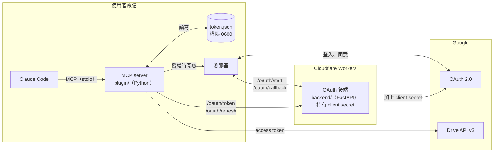
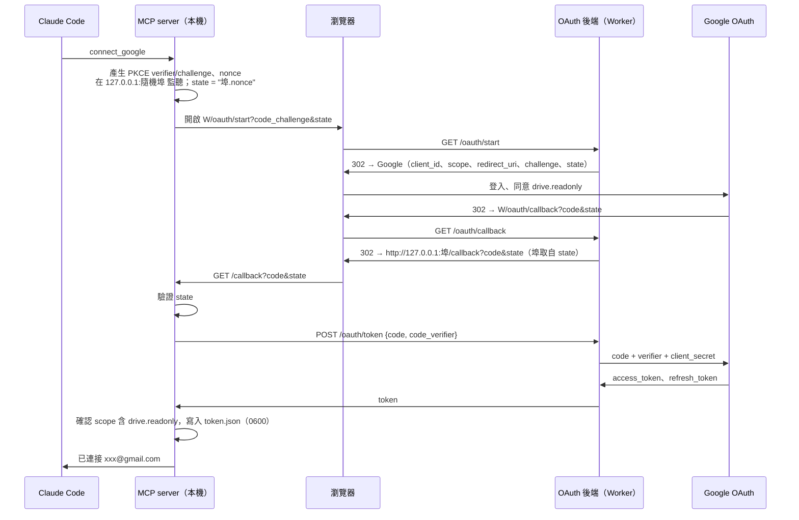
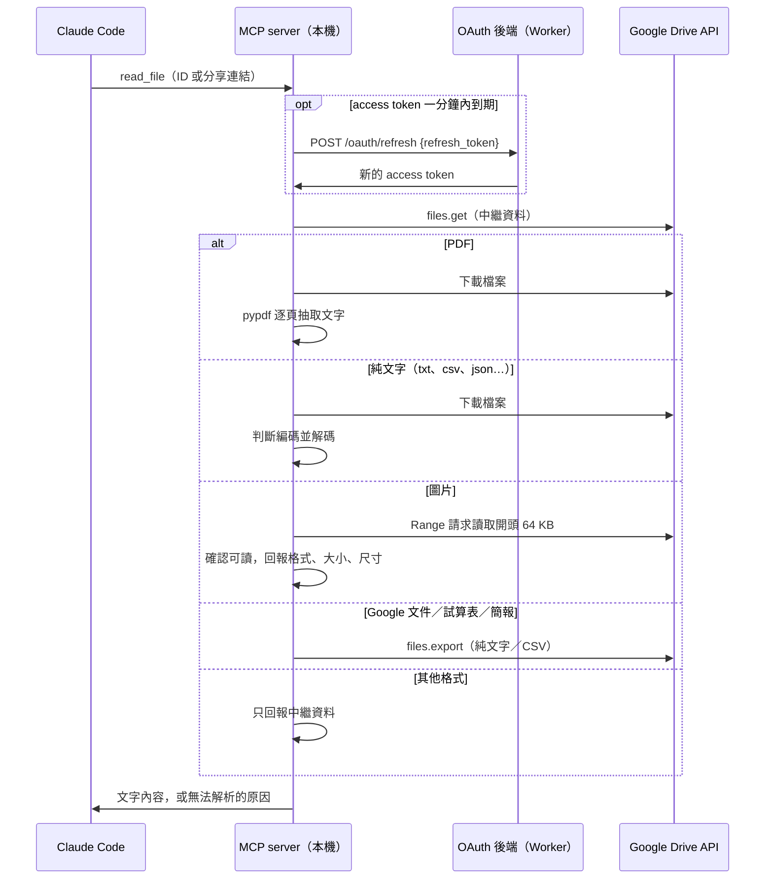

# 架構說明

## 1. 元件

| 元件 | 位置 | 負責 |
| --- | --- | --- |
| Plugin | `plugin/.claude-plugin/`、`plugin/.mcp.json` | 讓 Claude Code 自動啟動 MCP server，不含任何密鑰 |
| MCP server | `plugin/src/gdrive_reader/` | 5 個工具、PKCE 與 loopback、token 存放與更新、Drive 讀取、PDF 抽文字 |
| OAuth 後端 | `backend/src/worker.py` | 組授權網址、把 callback 轉回本機、用 client secret 換發與更新 token；不存 token，也不碰檔案內容 |

## 2. 授權流程

## 3. 讀取流程

Drive API 由本機直接呼叫，檔案內容不經過後端。遇到 401 會強制更新 token 後重試一次；429、5xx 以指數退避重試。

## 4. 技術選擇

### 4.1 OAuth Client：Web application＋自架後端

- **選擇**：使用 Web application 類型的 OAuth Client，client secret 只放在 Cloudflare Worker 的 secret 裡。
- **理由**：Desktop app 類型的 secret 必須跟著程式發到每台電腦，Google 也說明桌面程式無法保密 secret。改用 Web client 搭配自己的後端，secret 就不會離開伺服器，repo 和 plugin 裡都沒有任何密鑰。

### 4.2 Authorization Code＋PKCE，callback 轉回本機

- **選擇**：Authorization Code flow 加 PKCE（S256）。後端收到 Google 的 callback 後，不換 token，只把 `code` 轉回本機的 `127.0.0.1` loopback；本機帶著 verifier 回來，後端才向 Google 換 token。
- **理由**：verifier 只存在本機程序裡，授權碼就算留在瀏覽器紀錄中也無法單獨使用。loopback 的 port 編在 `state` 裡（`<port>.<nonce>`），後端不需要資料庫或 session 就知道要轉去哪裡，而且只允許轉到 `127.0.0.1` 的 1024–65535 port，不會變成 open redirect。`state` 由本機驗證，對不上的回呼直接拒絕，但不會中止正在進行的登入。

### 4.3 Token 存在本機檔案

- **選擇**：refresh token 和 access token 存在 `${CLAUDE_PLUGIN_DATA}/token.json`，也就是 Claude Code 給每個 plugin 的資料目錄。檔案權限 `0600`、目錄 `0700`，以暫存檔加 `os.replace` 原子寫入。
- **理由**：後端如果保存 refresh token，就要另外處理加密、存取控制和資料保留，也會變成集中被攻擊的目標。放在本機，後端可以完全無狀態。這個目錄在 plugin 更新時會保留、解除安裝時會刪除，不需要另外清理。不用 OS Keychain，是因為 macOS 第一次存取會跳出系統對話框，Linux 沒有桌面環境時也沒有 Secret Service；`gcloud`、`gh` 等 CLI 也是用同樣的檔案權限做法。

### 4.4 Scope：drive.readonly

- **選擇**：只申請 `https://www.googleapis.com/auth/drive.readonly`，不加 `openid`、`email`。帳號名稱改用 Drive 的 `about.get` 取得。
- **理由**：題目要列出既有資料夾的子項目並讀取內容，比較過的選項如下：

| Scope | 列出既有資料夾的子項目 | 讀取內容 | 同意畫面 |
| --- | --- | --- | --- |
| `drive.file`＋Google Picker | 不行：選取資料夾只授權資料夾本身，不含其中的檔案 | 可以 | 無警告 |
| `drive.metadata.readonly` | 可以 | 不行 | restricted |
| `drive.readonly`（採用） | 可以 | 可以 | restricted，未審核時顯示警告 |

  授權完成後會檢查 Google 實際給的 scope。使用者在同意畫面取消勾選 Drive 權限時，會直接告知要重新授權，而不是等到讀檔時才出現 403。

### 4.5 MCP server 在本機以 stdio 執行，直接呼叫 Drive REST API

- **選擇**：MCP server 跑在使用者電腦上，以 `uv run --frozen` 啟動並用 `uv.lock` 固定版本；Drive API 用 httpx 直接呼叫，不用 google-api-python-client。
- **理由**：token 只在本機，不需要對外開放的 MCP 服務，也不用再做一層使用者驗證。Drive 只用到 `files.get`、`files.list`、`files.export`、`about.get` 和下載這幾個端點，直接呼叫讓相依套件只有 `mcp`、`httpx`、`pypdf`、`charset-normalizer` 四個，第一次啟動下載得比較快，不容易超過 Claude Code 的 MCP 啟動時限。

## 5. 取捨

| 做法 | 換來的 | 放棄的 |
| --- | --- | --- |
| 自架後端保管 client secret | secret 不外流 | 後端停擺時無法登入或更新 token（已取得的 access token 仍可用到到期，最多 1 小時） |
| Token 存本機檔案 | 後端無狀態，不必保管使用者憑證 | 同一個系統帳號下的其他程式讀得到這個檔案 |
| `drive.readonly` | 能列出並讀取任何被分享的資料夾 | token 能讀該帳號所有看得到的檔案；未通過 Google 審核時會出現警告畫面，且上限 100 位使用者 |
